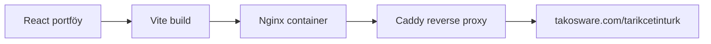

# Takosware Web

Tarık Çetintürk'ün portföy sitesi. Roomora, Gezzenti ve BuiltWhys çalışmalarını;
.NET backend deneyimini ve iletişim bağlantılarını tek sayfada toplar.

Canlı adres: [takosware.com/tarikcetinturk](https://takosware.com/tarikcetinturk)

## İçerik

- Roomora için ev ve gezi senaryoları, Android uygulamasından alınmış örnek veri ekranları ve iki mağazaya giden QR kodlar
- Kamyoon'un kamuya açık ürün ve Arkas Lojistik referans bilgilerine dayanan deneyim özeti
- Mobil menü, klavye ile kapatma ve dar ekranlarda yatay taşma kontrolleri

Örnek Roomora ekranlarındaki isimler ve tutarlar kurgusaldır. Görseller uygulamanın
Android sürümünden alınmıştır; iPhone ekran görüntüsü olarak sunulmaz.

## Yapı



Site statik bir React uygulamasıdır; kullanıcı verisi veya Roomora API bağlantısı içermez.

## Çalıştırma

```bash
npm install
npm run dev
```

## Doğrulama

```bash
npm run build
npm test
```

## Production

Container yerelde yalnızca `127.0.0.1:8092` portunu dinler. Sunucunun Caddy katmanı
`takosware.com` isteğini bu porta yönlendirir.

```bash
docker compose -f docker-compose.production.yml up -d --build
```
